# Silver Blaze -- extraction report

Generated by `scripts/validate_case.py` from `cases/silver-blaze.json`. Do not edit by hand.

**Checks:** PASS · 0 warning(s)

| entities | scenes | events | nodes | inferences | relations | actions | questions | quotes checked |
|---|---|---|---|---|---|---|---|---|
| 62 | 10 | 46 | 100 | 32 | 28 | 40 | 7 | 275 |

Node kinds: absence 7, background 16, document 3, hypothesis 7, inference 25, observation 6, physical 8, testimony 22, trace 6

## Scenes (reader order)

| # | scene | when | where | line |
|---|---|---|---|---|
| S1 | Breakfast at Baker Street | day 3 Thu | Holmes's rooms, London | 4 |
| S2 | The train to Exeter: the facts of the case | day 3 Thu | Railway carriage (Paddington-Exeter; later a Pullman car home) | 47 |
| S3 | Tavistock and the drive with Gregory | day 3 Thu | Tavistock | 347 |
| S4 | Straker's villa: the pockets and Mrs. Straker | day 3 Thu | Straker's villa | 466 |
| S5 | The hollow | day 3 Thu | The hollow where Straker died | 553 |
| S6 | Across the moor to Mapleton | day 3 Thu | The long hollow towards Mapleton | 634 |
| S7 | The walk back | day 3 Thu | Dartmoor | 762 |
| S8 | Departure: the photograph, the sheep, the dog ← challenge point | day 3 Thu | Straker's villa | 817 |
| S9 | The Wessex Cup | day 7 Mon | Winchester racecourse | 897 |
| S10 | The explanation on the train home | day 7 Mon | Railway carriage (Paddington-Exeter; later a Pullman car home) | 1022 |

## Fabula -- what really happened, in order

| # | when | event | basis | reader told | truth shown | line |
|---|---|---|---|---|---|---|
| 10 | before story | Straker serves Colonel Ross, first as jockey, then as trainer, with an apparently honest record. | narrated | S2 |  | 121 |
| 20 | before story | Straker sets up a second household as 'William Derbyshire' with a woman of expensive tastes and falls deeply into debt. | reconstructed | S10 |  | 1110 |
| 30 | before story | Straker plans to make money by laming his own favourite so that it loses (implicitly by betting against it through agents). | reconstructed | S10 |  | 1148 |
| 40 | before story | Straker practises the tendon-nick on the sheep in the paddock; three go lame. | reconstructed | S8 | S10 | 869 |
| 50 | before story | Simpson squanders a fortune on the turf and becomes a quiet bookmaker in London clubs. | narrated | S2 |  | 284 |
| 60 | before story | Simpson has twice lodged at Tavistock in the summer. | testified | S3 |  | 411 |
| 70 | before story | Simpson lays bets of £5,000 against the favourite. | narrated | S2 |  | 287 |
| 80 | before story | Silas Brown places large bets on the race; he is no friend of Straker. | testified | S3 |  | 442 |
| 90 | before story | Simpson comes to Dartmoor for information on the King's Pyland horses and Desborough, lodging at the villas. | testified | S2 |  | 290 |
| 100 | day 0 Mon | A party of gypsies camps within a mile of the hollow. | testified | S3 |  | 425 |
| 110 | day 0 Mon | Curried mutton is served for supper in the Straker household that night -- chosen by Straker (or his wife), as only they could. | reconstructed | S2 | S10 | 1057 |
| 120 | day 0 Mon 21:00 | The horses are exercised and watered and the stables locked up. | narrated | S2 |  | 142 |
| 130 | day 0 Mon 21:00~ | Two lads go up to the trainer's house to sup in the kitchen; Ned Hunter stays on guard. | narrated | S2 |  | 142 |
| 140 | day 0 Mon 21:00~ | Straker puts powdered opium into the portion set aside for Hunter. | reconstructed | S10 |  | 1058 |
| 150 | day 0 Mon 21:05~ | Edith Baxter carries the curried mutton across the moor to the stable, with a lantern. No drink: the lad on duty drinks only from the stable tap. | narrated | S2 |  | 144 |
| 160 | day 0 Mon 21:05~ | Thirty yards from the stable, Simpson stops Edith, asks where he is, and offers her a dress if the boy gets a folded paper. | testified | S2 |  | 172 |
| 170 | day 0 Mon 21:10~ | At the stable window Simpson asks Hunter for a tip on Silver Blaze and Bayard. | testified | S2 |  | 190 |
| 180 | day 0 Mon 21:10~ | Hunter goes to unloose the dog, locks the door behind him, and runs out with the hound; the stranger has gone. Edith, fleeing, sees the stranger leaning through the window. | testified | S2 |  | 196 |
| 190 | day 0 Mon | Simpson, fleeing, drops his cravat. | reconstructed | S10 |  | 1123 |
| 200 | day 0 Mon | Hunter eats the curried mutton and sinks into a drugged stupor. | implied | S2 |  | 233 |
| 210 | day 0 Mon | When the other lads return, Hunter sends word to Straker, who is excited and vaguely uneasy. | narrated | S2 |  | 213 |
| 220 | day 1 Tue | Heavy rain, no wind. | testified | S2 |  | 559 |
| 230 | day 1 Tue 01:00~ | Straker dresses, tells his wife he is anxious about the horses, picks up the cataract knife from the dressing-table, and goes out in his mackintosh. | testified | S2 | S10 | 216 |
| 240 | day 1 Tue | Straker enters the stable -- the dog knows him and stays quiet, the lads sleep, Hunter is drugged -- bridles Silver Blaze and leads him out, leaving the door open. | reconstructed | S10 |  | 1071 |
| 250 | day 1 Tue | Straker picks up Simpson's dropped cravat, perhaps to tie the horse's leg. | reconstructed | S10 |  | 1124 |
| 260 | day 1 Tue | In the hollow, where his light cannot be seen, Straker takes off his overcoat and lays it over the furze-bush. | reconstructed | S10 |  | 1122 |
| 270 | day 1 Tue | Behind the horse, Straker strikes a wax vesta (to light his candle). | reconstructed | S10 |  | 1126 |
| 280 | day 1 Tue | Frightened by the flare, Silver Blaze lashes out; the steel shoe strikes Straker on the forehead. Falling, Straker gashes his own thigh with the knife. | reconstructed | S9 | S10 | 1129 |
| 290 | day 1 Tue | Silver Blaze bolts alone across the moor towards Mapleton, leaving tracks in the wet hollow. | reconstructed | S6 |  | 1154 |
| 300 | day 1 Tue | Silas Brown, first up, sees a strange horse near Mapleton, recognises the white forehead, and starts leading it back towards King's Pyland. | reconstructed | S7 |  | 774 |
| 310 | day 1 Tue | Tempted, Brown turns back, hides the horse at Mapleton until after the race, and disguises it (the white forehead and mottled leg are covered). | reconstructed | S7 | S9 | 781 |
| 320 | day 1 Tue 07:00~ | Mrs. Straker and the maid find the stable door open, Hunter in a stupor, the stall empty. | narrated | S2 |  | 224 |
| 330 | day 1 Tue | From the knoll the searchers see the coat on the furze-bush and find Straker's body in the hollow. | narrated | S2 |  | 244 |
| 340 | day 1 Tue | The gypsies are gone. | testified | S3 |  | 427 |
| 350 | day 1 Tue | Gregory arrests Simpson at the villas. | narrated | S2 |  | 280 |
| 360 | day 1 Tue | Colonel Ross and Inspector Gregory telegraph Holmes. | narrated | S2 |  | 71 |
| 370 | day 1 Tue–3 | Gregory searches every stable and outhouse within ten miles, Mapleton included, and finds nothing. | testified | S3 |  | 434 |
| 380 | day 2 Wed | Holmes stays in London expecting the horse to be found -- his admitted blunder. | narrated | S2 |  | 80 |
| 390 | day 3 Thu | Holmes and Watson investigate on Dartmoor (see actions). | narrated | S1 |  |  |
| 400 | day 3 Thu | Broken by Holmes, Brown agrees to keep the horse safe and produce it for the race as instructed. | narrated | S6 |  | 745 |
| 410 | day 4 | The inquest on Straker is due (its outcome is never told). | implied | S3 |  | 479 |
| 420 | day 4–6 | Holmes shows Straker's photograph to the milliner, who knows him as 'Derbyshire'. | narrated | S10 |  | 1144 |
| 440 | day 4–7 | Ross scratches his other horse and stakes everything on Holmes's word. | testified | S9 |  | 934 |
| 445 | day 6–7 | The odds on Silver Blaze shorten from fifteen to one to three to one: 'somebody knows something'. | testified | S9 |  | 915 |
| 450 | day 7 Mon | A bay with no white hair, in Ross's colours, wins the Wessex Cup by six lengths from Desborough. | narrated | S9 |  | 967 |
| 460 | day 7 Mon | Holmes reveals the winner is Silver Blaze in disguise, and names the horse as Straker's killer. | narrated | S9 |  | 1010 |

## Investigation -- who did what, in order

Happens = the scene it takes place in; Told = where the reader learns of it. A gap is Holmes keeping his reasoning back.

| # | when | actor | verb | action | happens | told | yields |
|---|---|---|---|---|---|---|---|
| 10 | day 1 Tue 07:00~ | mrs_straker | search | Mrs. Straker and the maid go down to the stables when Straker has not come back. |  | S2 | ev.stable_found_open |
| 20 | day 1 Tue | other_lads | search | The lads and the two women search; from the knoll they see the coat and find the body in the hollow. |  | S2 | ev.coat_on_bush, ev.body_wounds, ev.knife_in_hand, ev.cravat_in_hand, ev.hoofprints_in_hollow |
| 30 | day 1 Tue | gregory | question | The police take statements from the maid, Hunter (once recovered), the lads and Mrs. Straker. *(offstage)* |  | S2 | ev.edith_account, ev.tout_at_window, ev.paper_in_hand, ev.dog_in_stable, ev.lads_heard_nothing, ev.lad_supper_curry, ev.hunter_blames_stranger, ev.straker_uneasy, ev.straker_went_out, ev.cravat_identified, ev.bridle_missing, ev.horse_not_found, ev.knife_from_dressing_table, ev.derbyshire_friend |
| 40 | day 1 Tue–2 | gregory | test | The remains of Hunter's supper are analysed. *(offstage)* |  | S2 | ev.opium_in_supper |
| 50 | day 1 Tue | gregory | arrest | Gregory finds and arrests Simpson at the villas, examines his betting-book, stick and clothes, and takes his statement. |  | S2 | ev.betting_book, ev.simpson_statement, ev.simpson_cravat_reaction, ev.simpson_wet, ev.penang_lawyer, ev.no_wound_on_simpson, ev.ten_pound_note, ev.simpson_lost_cravat, ev.no_duplicate_key, hyp.police_theory |
| 60 | day 1 Tue–3 | gregory | search | Gregory finds the gypsy camp, scours the moor, searches every stable within ten miles (Mapleton included), and learns Simpson's history and Brown's bets. *(offstage)* |  | S3 | ev.gypsy_camp, ev.simpson_knows_district, ev.brown_bets, ev.stables_searched, ev.no_simpson_mapleton_link, hyp.gypsy_theory |
| 70 | day 1 Tue | colonel_ross | send_message | Ross and Gregory telegraph Holmes asking for his help. |  | S2 |  |
| 100 | day 2 Wed | holmes | read | Holmes reads every edition of the papers and the telegrams, sifting fact from surmise -- and waits for the horse to turn up. | S1 | S1 | ev.edith_account, ev.tout_at_window, ev.paper_in_hand, ev.dog_in_stable, ev.lads_heard_nothing, ev.lad_supper_curry, ev.opium_in_supper, ev.hunter_blames_stranger, ev.straker_uneasy, ev.straker_went_out, ev.stable_found_open, ev.bridle_missing, ev.horse_not_found, ev.coat_on_bush, ev.body_wounds, ev.knife_in_hand, ev.cravat_in_hand, ev.cravat_identified, ev.hoofprints_in_hollow, ev.betting_book, ev.simpson_statement, ev.simpson_cravat_reaction, ev.simpson_wet, ev.penang_lawyer, ev.no_wound_on_simpson, hyp.police_theory, hyp.horse_soon_found |
| 110 | day 2 Wed | holmes | send_message | Struck by the question of whether Hunter left the door unlocked when he ran out, Holmes sends a special wire to Dartmoor. *(offstage)* |  | S2 | ev.door_locked |
| 120 | day 3 Thu | holmes | observe | Holmes times the telegraph posts and gives the train's speed. | S2 | S2 | inf.train_speed |
| 130 | day 3 Thu | watson | reason | Watson suggests the thigh wound came from Straker's own knife. | S2 | S2 | hyp.knife_self_wound |
| 140 | day 3 Thu | holmes | travel | Holmes and Watson take the train to Tavistock, where Ross and Gregory meet them. | S2 | S3 ⟵ |  |
| 150 | day 3 Thu | holmes | question | In the landau Holmes puts his objections to the police case; Gregory answers them and adds the gypsies and Mapleton. | S3 | S3 | ev.ten_pound_note, ev.simpson_knows_district, ev.simpson_lost_cravat, ev.no_duplicate_key, ev.gypsy_camp, ev.brown_bets, ev.stables_searched, ev.no_simpson_mapleton_link, hyp.gypsy_theory |
| 160 | day 3 Thu | holmes | reason | Arriving at the trainer's house, Holmes sits on in the carriage, 'day-dreaming': the significance of the curried mutton has struck him. | S3 | S10 ⟵ | inf.drugger_knew_curry, inf.simpson_did_not_drug, inf.opium_added_after_serving, inf.drugger_in_household |
| 170 | day 3 Thu | holmes | reason | Holmes grasps the silence of the dog, and from it that Straker himself took out the horse, for a dishonest purpose. | S3 | S10 ⟵ | inf.visitor_known_to_dog, inf.straker_took_horse, inf.straker_drugged_lad, inf.straker_dishonest |
| 180 | day 3 Thu | holmes | examine | Holmes asks to see what Straker had in his pockets; Watson identifies the cataract knife; Gregory relays Mrs. Straker's statements about the knife and Derbyshire. | S4 | S4 | ev.pocket_contents, ev.cataract_knife, ev.knife_from_dressing_table, ev.milliner_bill, ev.derbyshire_friend |
| 190 | day 3 Thu | holmes | reason | A cataract knife means a delicate operation; the operation is laming the horse; it must be done in the open by candlelight. | S4 | S10 ⟵ | inf.knife_for_operation, inf.plan_to_lame, inf.done_in_the_open |
| 200 | day 3 Thu | holmes | reason | A man does not carry another man's bills: Straker is leading a double life. | S4 | S10 ⟵ | hyp.derbyshire_is_straker |
| 210 | day 3 Thu | holmes | trick | Holmes pretends to remember Mrs. Straker from a Plymouth garden-party in a dove-coloured silk costume; she has never had such a dress. | S4 | S4 | ev.wife_never_had_dress |
| 220 | day 3 Thu | holmes | examine | At the hollow Holmes asks about the wind: there was none, so the coat was placed on the bush. | S5 | S5 | ev.no_wind, inf.coat_placed |
| 230 | day 3 Thu | holmes | obtain_item | Gregory hands over his bag: Straker's boot, Simpson's shoe, and a cast horseshoe of Silver Blaze. | S5 | S5 | item:straker_boot, item:simpson_shoe, item:horseshoe |
| 240 | day 3 Thu | holmes | search | Lying on the matting, Holmes searches the trampled mud -- looking for a match -- and finds a half-burned wax vesta. | S5 | S5 | ev.wax_vesta |
| 250 | day 3 Thu | holmes | examine | Holmes compares the boots with the marks in the hollow and crawls about the rim. | S5 | S5 | ev.boot_impressions |
| 260 | day 3 Thu | holmes | arrange | Holmes tells Ross not to withdraw Silver Blaze from the Cup. | S5 | S5 |  |
| 270 | day 3 Thu | holmes | reason | Walking over the moor: the horse is gregarious, the gypsies would not take it, it is not at King's Pyland -- so, as a working hypothesis, it is at Mapleton. | S6 | S6 | inf.not_gypsies, hyp.horse_at_mapleton |
| 280 | day 3 Thu | holmes | search | Holmes and Watson search both banks of the wet hollow towards Mapleton; Holmes finds a hoofprint the horseshoe fits. | S6 | S6 | ev.horse_track_wet_hollow, inf.horse_went_toward_mapleton |
| 290 | day 3 Thu | holmes | follow_tracks | They follow the track; a man's prints join it; it turns towards King's Pyland -- Watson spots it coming back -- and ends at the Mapleton gates. | S6 | S6 | ev.mans_track_loop, ev.square_toes, inf.man_led_horse_back |
| 300 | day 3 Thu | holmes | question | Holmes asks the groom Dawson whether Brown would be up at five tomorrow morning. | S6 | S6 | ev.brown_first_up, inf.man_was_brown |
| 310 | day 3 Thu | holmes | confront | Holmes whispers to Brown what he did that morning, follows him inside for twenty minutes, and leaves him promising to keep the horse safe and produce it as instructed. | S6 | S6 | ev.brown_capitulates, inf.brown_hid_horse, inf.horse_disguised |
| 320 | day 3 Thu | holmes | reason | With the vesta found and the horse accounted for, Holmes has the whole night's story: the cravat, the light, the kick. (He keeps it to himself.) | S7 | S10 ⟵ | inf.cravat_picked_up, inf.horse_killed_straker, inf.simpson_innocent |
| 330 | day 3 Thu | holmes | obtain_item | Holmes asks Gregory for a photograph of Straker. | S8 | S8 | item:photograph |
| 340 | day 3 Thu | holmes | question | Holmes leaves the room to put a question to the maid. Neither question nor answer is ever told. *(offstage)* | S8 | S8 |  **(unknown)** |
| 350 | day 3 Thu | holmes | reason | Straker would have practised first -- on what? Holmes's eyes fall on the sheep. | S8 | S10 ⟵ | hyp.practised_on_sheep |
| 360 | day 3 Thu | holmes | question | Getting into the carriage, Holmes asks the stable-lad whether anything is amiss with the sheep: three have gone lame. | S8 | S8 | ev.sheep_lame, inf.practised_on_sheep |
| 370 | day 3 Thu | holmes | report | Holmes directs Gregory to the sheep and to 'the curious incident of the dog in the night-time'. | S8 | S8 |  |
| 380 | day 3 Thu | holmes | travel | Holmes and Watson return to London by the night train. |  | S7 |  |
| 390 | day 4–6 | holmes | question | In London Holmes shows Straker's photograph to the milliner on Bond Street. *(offstage)* |  | S10 | ev.milliner_identifies, inf.straker_is_derbyshire, inf.debt_motive |
| 400 | day 4–6 | holmes | send_message | Holmes writes to Brown with his instructions (keep the disguise on; send the horse to the race). *(offstage)* |  | S6 |  |
| 410 | day 7 Mon | holmes | reveal | At Winchester the disguised horse runs in Ross's colours and wins; Holmes tells Ross to wash its face and leg in spirits of wine, and names the horse as Straker's killer. | S9 | S9 | ev.betting_shortened, ev.no_white_hair |
| 420 | day 7 Mon | holmes | report | On the train home Holmes explains everything to Ross and Watson. | S10 | S10 |  |

## Clues -- discovery and disclosure

| node | kind | relevance | truth | protagonists get it | reader meets it | meaning explained | line |
|---|---|---|---|---|---|---|---|
| `ev.edith_account` The stranger on the path | testimony | supporting | true | a.read_papers | S2 |  | 157 |
| `ev.tout_at_window` The tout at the window | testimony | key | true | a.read_papers | S2 |  | 195 |
| `ev.paper_in_hand` The paper in his hand | testimony | red_herring | true | a.read_papers | S2 |  | 183 |
| `ev.dog_in_stable` A dog in the stable | testimony | key | true | a.read_papers | S2 | S10 | 196 |
| `ev.door_locked` The door was locked | testimony | supporting | true | a.wire_about_door | S2 |  | 208 |
| `ev.lads_heard_nothing` The lads heard nothing | absence | key | true | a.read_papers | S2 | S10 | 232 |
| `ev.lad_supper_curry` Curried mutton | testimony | key | true | a.read_papers | S2 | S10 | 146 |
| `ev.opium_in_supper` Opium in the leftovers | document | key | true | a.read_papers | S2 | S10 | 268 |
| `ev.hunter_blames_stranger` Hunter blames the stranger | testimony | red_herring | false | a.read_papers | S2 |  | 259 |
| `ev.straker_uneasy` Straker was uneasy | testimony | flavour | true | a.read_papers | S2 |  | 213 |
| `ev.straker_went_out` Out at one in the morning | testimony | key | true | a.read_papers | S2 |  | 216 |
| `ev.stable_found_open` Door open, stall empty | observation | key | true | a.read_papers | S2 |  | 226 |
| `ev.bridle_missing` No bridle | absence | supporting | true | a.read_papers | S2 |  | 332 |
| `ev.horse_not_found` The horse has vanished | absence | key | true | a.read_papers | S2 |  | 265 |
| `ev.coat_on_bush` Coat on the furze-bush | physical | key | true | a.read_papers | S2 |  | 244 |
| `ev.body_wounds` The body | physical | key | true | a.read_papers | S2 | S10 | 247 |
| `ev.knife_in_hand` Bloody knife in his right hand | physical | key | true | a.read_papers | S2 |  | 252 |
| `ev.cravat_in_hand` Cravat in his left hand | physical | red_herring | true | a.read_papers | S2 | S10 | 253 |
| `ev.cravat_identified` The stranger's cravat | testimony | red_herring | true | a.read_papers | S2 |  | 254 |
| `ev.hoofprints_in_hollow` Hoofprints in the hollow | trace | key | true | a.read_papers | S2 |  | 263 |
| `ev.betting_book` £5,000 against the favourite | document | red_herring | true | a.read_papers | S2 |  | 287 |
| `ev.simpson_statement` Simpson's statement | testimony | supporting | true | a.read_papers | S2 |  | 296 |
| `ev.simpson_cravat_reaction` Simpson turns pale | observation | red_herring | true | a.read_papers | S2 |  | 297 |
| `ev.simpson_wet` Simpson's wet clothes | observation | red_herring | true | a.read_papers | S2 |  | 299 |
| `ev.penang_lawyer` A loaded stick | physical | red_herring | true | a.read_papers | S2 |  | 300 |
| `ev.no_wound_on_simpson` No wound on Simpson | absence | supporting | true | a.read_papers | S2 |  | 305 |
| `ev.ten_pound_note` A ten-pound note | testimony | supporting | unverified | a.question_gregory | S3 |  | 409 |
| `ev.simpson_knows_district` Not a stranger here | testimony | red_herring | true | a.question_gregory | S3 |  | 411 |
| `ev.simpson_lost_cravat` "I lost it" | testimony | supporting | true | a.question_gregory | S3 |  | 419 |
| `ev.no_duplicate_key` No key found | absence | supporting | true | a.question_gregory | S3 |  | 402 |
| `ev.gypsy_camp` Gypsy camp traces | trace | red_herring | true | a.question_gregory | S3 |  | 425 |
| `ev.brown_bets` Brown's bets | testimony | supporting | true | a.question_gregory | S3 |  | 442 |
| `ev.stables_searched` Mapleton searched: nothing | absence | supporting | true | a.question_gregory | S3 | S9 | 444 |
| `ev.no_simpson_mapleton_link` Simpson and Mapleton unconnected | absence | flavour | true | a.question_gregory | S3 |  | 447 |
| `ev.pocket_contents` Straker's pockets | physical | key | true | a.examine_pockets | S4 | S10 | 493 |
| `ev.cataract_knife` A cataract knife | physical | key | true | a.examine_pockets | S4 | S10 | 506 |
| `ev.knife_from_dressing_table` Taken from the dressing-table | testimony | key | true | a.examine_pockets | S4 |  | 513 |
| `ev.milliner_bill` A bill for 'William Derbyshire' | document | key | true | a.examine_pockets | S4 | S10 | 521 |
| `ev.derbyshire_friend` "A friend of my husband's" | testimony | supporting | false | a.examine_pockets | S4 |  | 524 |
| `ev.wife_never_had_dress` "I never had such a dress" | testimony | key | true | a.dress_trick | S4 | S10 | 547 |
| `ev.no_wind` No wind that night | testimony | supporting | true | a.examine_coat | S5 |  | 557 |
| `ev.wax_vesta` A burnt match in the mud | physical | key | true | a.search_mud | S5 | S10 | 583 |
| `ev.boot_impressions` Boot impressions | trace | flavour | unverified | a.compare_boots | S5 |  | 596 |
| `ev.horse_track_wet_hollow` Hoofprint towards Mapleton | trace | key | true | a.search_wet_hollow | S6 |  | 665 |
| `ev.mans_track_loop` A man's track joins it | trace | key | true | a.follow_tracks | S6 |  | 678 |
| `ev.square_toes` Square toes | trace | key | true | a.follow_tracks | S7 |  | 770 |
| `ev.brown_first_up` Always the first stirring | testimony | supporting | true | a.ask_groom | S6 |  | 705 |
| `ev.brown_capitulates` Brown breaks | observation | key | true | a.confront_brown | S6 |  | 724 |
| `ev.sheep_lame` Three lame sheep | testimony | key | true | a.ask_about_sheep | S8 | S10 | 869 |
| `ev.betting_shortened` The odds shorten | observation | flavour | true | a.at_the_race | S9 |  | 915 |
| `ev.no_white_hair` Not a white hair | observation | key | true | a.at_the_race | S9 |  | 910 |
| `ev.milliner_identifies` The milliner knows him | testimony | key | true | a.visit_milliner | S10 |  | 1144 |
| `bg.dog_barks_at_strangers` Watchdogs bark at strangers | background | key | true | from start | S2 | S10 | 195 |
| `bg.opium_taste` Opium can be tasted | background | key | true | from start | S10 |  | 1045 |
| `bg.curry_masks` Curry hides the taste | background | key | true | from start | S10 |  | 1048 |
| `bg.wind_and_coats` Without wind, a coat does not blow | background | supporting | true | from start | S5 |  | 561 |
| `bg.cataract_knife_use` What a cataract knife is for | background | key | true | from start | S4 | S10 | 508 |
| `bg.tendon_nick` Nicking a tendon | background | key | true | from start | S10 |  | 1088 |
| `bg.laying_against` Trainers who bet against their horses | background | supporting | true | from start | S10 |  | 1075 |
| `bg.horse_would_wake_sleepers` A pricked horse is loud | background | supporting | true | from start | S10 |  | 1098 |
| `bg.others_bills` Nobody carries another man's bills | background | key | true | from start | S10 |  | 1108 |
| `bg.servant_wages` A trainer's wage | background | supporting | true | from start | S10 |  | 1114 |
| `bg.practise_first` Practise first | background | supporting | true | from start | S10 |  | 1139 |
| `bg.horse_gregarious` Horses go home | background | key | true | from start | S6 |  | 638 |
| `bg.gypsies_avoid_trouble` Gypsies avoid trouble | background | supporting | true | from start | S6 |  | 642 |
| `bg.wet_ground_holds_tracks` Wet ground keeps tracks | background | supporting | true | from start | S6 |  | 655 |
| `bg.disguise_washes_off` Faker's dye | background | supporting | true | from start | S9 |  | 978 |
| `bg.telegraph_posts` Telegraph posts | background | flavour | true | from start | S2 |  | 53 |
| `inf.train_speed` 53½ miles an hour | inference | flavour | true | a.time_the_train | S2 |  | 48 |
| `inf.coat_placed` The coat was placed | inference | key | true | a.examine_coat | S5 |  | 561 |
| `inf.drugger_knew_curry` The drugger knew about the curry | inference | key | true | a.realise_curry | S10 |  | 1052 |
| `inf.simpson_did_not_drug` Simpson did not drug the lad | inference | key | true | a.realise_curry | S10 |  | 1055 |
| `inf.opium_added_after_serving` Drugged after it was dished up | inference | supporting | true | a.realise_curry | S10 |  | 1058 |
| `inf.drugger_in_household` The drugger was Straker or his wife | inference | key | true | a.realise_curry | S10 |  | 1056 |
| `inf.visitor_known_to_dog` The dog knew the visitor | inference | key | true | a.realise_dog | S8 | S10 | 891 |
| `inf.straker_took_horse` Straker took out the horse | inference | key | true | a.realise_dog | S10 |  | 1071 |
| `inf.straker_drugged_lad` Straker drugged his own lad | inference | key | true | a.realise_dog | S10 |  | 1074 |
| `inf.straker_dishonest` His purpose was dishonest | inference | key | true | a.realise_dog | S10 |  | 1073 |
| `inf.knife_for_operation` The knife was for an operation | inference | key | true | a.reason_about_knife | S10 |  | 1086 |
| `inf.plan_to_lame` He meant to lame the horse | inference | key | true | a.reason_about_knife | S10 |  | 1088 |
| `inf.done_in_the_open` Out on the moor, by candlelight | inference | key | true | a.reason_about_knife | S10 |  | 1100 |
| `hyp.derbyshire_is_straker` Is Derbyshire Straker? | hypothesis | key | true | a.reason_about_bill | S10 |  | 1110 |
| `inf.straker_is_derbyshire` Straker WAS Derbyshire | inference | key | true | a.visit_milliner | S10 |  | 1118 |
| `inf.debt_motive` The motive: debt | inference | key | true | a.visit_milliner | S10 |  | 1147 |
| `hyp.practised_on_sheep` Did he practise on something? | hypothesis | supporting | true | a.reason_about_practice | S10 |  | 1140 |
| `inf.practised_on_sheep` He practised on the sheep | inference | supporting | true | a.ask_about_sheep | S10 |  | 1142 |
| `inf.cravat_picked_up` Straker picked up the cravat | inference | key | true | a.reconstruct_death | S10 |  | 1123 |
| `inf.horse_killed_straker` The horse killed him | inference | key | true | a.reconstruct_death | S9 | S10 | 1010 |
| `inf.simpson_innocent` Simpson is innocent | inference | key | true | a.reconstruct_death | S10 |  | 1055 |
| `inf.not_gypsies` Not the gypsies | inference | supporting | true | a.reason_about_horse | S6 |  | 644 |
| `hyp.horse_at_mapleton` Working hypothesis: Mapleton | hypothesis | key | true | a.reason_about_horse | S6 |  | 651 |
| `inf.horse_went_toward_mapleton` The horse went to Mapleton, alone | inference | key | true | a.search_wet_hollow | S6 |  | 669 |
| `inf.man_led_horse_back` Someone met the horse | inference | key | true | a.follow_tracks | S6 |  | 687 |
| `inf.man_was_brown` The man was Silas Brown | inference | key | true | a.ask_groom | S7 |  | 772 |
| `inf.brown_hid_horse` Brown is hiding Silver Blaze | inference | key | true | a.confront_brown | S7 |  | 777 |
| `inf.horse_disguised` The horse is disguised | inference | key | true | a.confront_brown | S9 |  | 984 |
| `hyp.police_theory` The police theory | hypothesis | red_herring | false | a.read_papers | S2 |  | 328 |
| `hyp.knife_self_wound` Watson: a self-inflicted cut | hypothesis | supporting | partly_true | a.watson_suggests_knife | S2 |  | 317 |
| `hyp.gypsy_theory` Gregory: the gypsies have him | hypothesis | red_herring | false | a.question_gregory | S3 |  | 428 |
| `hyp.horse_soon_found` Holmes's blunder | hypothesis | red_herring | false | a.read_papers | S2 |  | 83 |

## Fair play -- could a reader solve it by the challenge point (S8)?

For each question: every node its answer rests on (the premises, recursively). Evidence and rules the reader first meets after the challenge point are listed -- those are what a solving reader was not given. Reasoning nodes are left out: working them out is the reader's job.

- **Who drugged Ned Hunter's supper?** -- John Straker, his own employer, after the dish was set aside. → *2 of 11 needed clues withheld*
  - `bg.curry_masks` (background, reader meets it in S10)
  - `bg.opium_taste` (background, reader meets it in S10)
- **Who took Silver Blaze out of the stable?** -- John Straker. → *2 of 11 needed clues withheld*
  - `bg.curry_masks` (background, reader meets it in S10)
  - `bg.opium_taste` (background, reader meets it in S10)
- **Why was the horse taken out?** -- To lame it with a nick to the tendon, out on the moor where the noise and light would not be noticed, so that it would lose. → *5 of 18 needed clues withheld*
  - `bg.curry_masks` (background, reader meets it in S10)
  - `bg.horse_would_wake_sleepers` (background, reader meets it in S10)
  - `bg.laying_against` (background, reader meets it in S10)
  - `bg.opium_taste` (background, reader meets it in S10)
  - `bg.tendon_nick` (background, reader meets it in S10)
- **Who killed John Straker?** -- Silver Blaze, in self-defence: kicked when Straker struck a light behind him. → *5 of 25 needed clues withheld*
  - `bg.curry_masks` (background, reader meets it in S10)
  - `bg.horse_would_wake_sleepers` (background, reader meets it in S10)
  - `bg.laying_against` (background, reader meets it in S10)
  - `bg.opium_taste` (background, reader meets it in S10)
  - `bg.tendon_nick` (background, reader meets it in S10)
- **Where is Silver Blaze?** -- At Mapleton, hidden and disguised by Silas Brown. → *1 of 13 needed clues withheld*
  - `bg.disguise_washes_off` (background, reader meets it in S9)
- **Why did Straker do it?** -- He was deep in debt from a secret second household as 'William Derbyshire'. → *7 of 22 needed clues withheld*
  - `bg.curry_masks` (background, reader meets it in S10)
  - `bg.laying_against` (background, reader meets it in S10)
  - `bg.opium_taste` (background, reader meets it in S10)
  - `bg.others_bills` (background, reader meets it in S10)
  - `bg.servant_wages` (background, reader meets it in S10)
  - `bg.tendon_nick` (background, reader meets it in S10)
  - `ev.milliner_identifies` (testimony, reader meets it in S10)
- **Is Fitzroy Simpson guilty?** -- No. He was only a tout trying to buy a tip; he dropped his cravat as he ran. → *5 of 27 needed clues withheld*
  - `bg.curry_masks` (background, reader meets it in S10)
  - `bg.horse_would_wake_sleepers` (background, reader meets it in S10)
  - `bg.laying_against` (background, reader meets it in S10)
  - `bg.opium_taste` (background, reader meets it in S10)
  - `bg.tendon_nick` (background, reader meets it in S10)

## Clue graph

Rectangles = evidence, rounded = background rules, hexagons = conclusions, dashed = hypotheses. Each small circle is one inference step (its premises are its 'ports'). Red edges = refutes/contradicts; dotted = misleads.

```mermaid
flowchart LR
  classDef ev fill:#e8f0fe,stroke:#4a6fa5;
  classDef bg fill:#f3f3f3,stroke:#999;
  classDef rs fill:#e6f4ea,stroke:#3a7d44;
  classDef hyp fill:#fff4e5,stroke:#c77700,stroke-dasharray:4 3;
  classDef bad fill:#fdecea,stroke:#b3261e,stroke-dasharray:4 3;
  classDef step fill:#fff,stroke:#666;
  ev_edith_account["The stranger on the path"]:::ev
  ev_tout_at_window["The tout at the window"]:::ev
  ev_paper_in_hand["The paper in his hand"]:::ev
  ev_dog_in_stable["A dog in the stable"]:::ev
  ev_door_locked["The door was locked"]:::ev
  ev_lads_heard_nothing["The lads heard nothing"]:::ev
  ev_lad_supper_curry["Curried mutton"]:::ev
  ev_opium_in_supper["Opium in the leftovers"]:::ev
  ev_hunter_blames_stranger["Hunter blames the stranger"]:::ev
  ev_straker_went_out["Out at one in the morning"]:::ev
  ev_stable_found_open["Door open, stall empty"]:::ev
  ev_bridle_missing["No bridle"]:::ev
  ev_horse_not_found["The horse has vanished"]:::ev
  ev_coat_on_bush["Coat on the furze-bush"]:::ev
  ev_body_wounds["The body"]:::ev
  ev_knife_in_hand["Bloody knife in his right hand"]:::ev
  ev_cravat_in_hand["Cravat in his left hand"]:::ev
  ev_cravat_identified["The stranger's cravat"]:::ev
  ev_hoofprints_in_hollow["Hoofprints in the hollow"]:::ev
  ev_betting_book["£5,000 against the favourite"]:::ev
  ev_simpson_statement["Simpson's statement"]:::ev
  ev_simpson_cravat_reaction["Simpson turns pale"]:::ev
  ev_simpson_wet["Simpson's wet clothes"]:::ev
  ev_penang_lawyer["A loaded stick"]:::ev
  ev_no_wound_on_simpson["No wound on Simpson"]:::ev
  ev_ten_pound_note["A ten-pound note"]:::ev
  ev_simpson_knows_district["Not a stranger here"]:::ev
  ev_simpson_lost_cravat["'I lost it'"]:::ev
  ev_no_duplicate_key["No key found"]:::ev
  ev_gypsy_camp["Gypsy camp traces"]:::ev
  ev_brown_bets["Brown's bets"]:::ev
  ev_stables_searched["Mapleton searched: nothing"]:::ev
  ev_pocket_contents["Straker's pockets"]:::ev
  ev_cataract_knife["A cataract knife"]:::ev
  ev_knife_from_dressing_table["Taken from the dressing-table"]:::ev
  ev_milliner_bill["A bill for 'William Derbyshire'"]:::ev
  ev_derbyshire_friend["'A friend of my husband's'"]:::ev
  ev_wife_never_had_dress["'I never had such a dress'"]:::ev
  ev_no_wind["No wind that night"]:::ev
  ev_wax_vesta["A burnt match in the mud"]:::ev
  ev_horse_track_wet_hollow["Hoofprint towards Mapleton"]:::ev
  ev_mans_track_loop["A man's track joins it"]:::ev
  ev_square_toes["Square toes"]:::ev
  ev_brown_first_up["Always the first stirring"]:::ev
  ev_brown_capitulates["Brown breaks"]:::ev
  ev_sheep_lame["Three lame sheep"]:::ev
  ev_no_white_hair["Not a white hair"]:::ev
  ev_milliner_identifies["The milliner knows him"]:::ev
  bg_dog_barks_at_strangers("Watchdogs bark at strangers"):::bg
  bg_opium_taste("Opium can be tasted"):::bg
  bg_curry_masks("Curry hides the taste"):::bg
  bg_wind_and_coats("Without wind, a coat does not blow"):::bg
  bg_cataract_knife_use("What a cataract knife is for"):::bg
  bg_tendon_nick("Nicking a tendon"):::bg
  bg_laying_against("Trainers who bet against their horses"):::bg
  bg_horse_would_wake_sleepers("A pricked horse is loud"):::bg
  bg_others_bills("Nobody carries another man's bills"):::bg
  bg_servant_wages("A trainer's wage"):::bg
  bg_practise_first("Practise first"):::bg
  bg_horse_gregarious("Horses go home"):::bg
  bg_gypsies_avoid_trouble("Gypsies avoid trouble"):::bg
  bg_wet_ground_holds_tracks("Wet ground keeps tracks"):::bg
  bg_disguise_washes_off("Faker's dye"):::bg
  inf_coat_placed{{"The coat was placed"}}:::rs
  inf_drugger_knew_curry{{"The drugger knew about the curry"}}:::rs
  inf_simpson_did_not_drug{{"Simpson did not drug the lad"}}:::rs
  inf_opium_added_after_serving{{"Drugged after it was dished up"}}:::rs
  inf_drugger_in_household{{"The drugger was Straker or his wife"}}:::rs
  inf_visitor_known_to_dog{{"The dog knew the visitor"}}:::rs
  inf_straker_took_horse{{"Straker took out the horse"}}:::rs
  inf_straker_drugged_lad{{"Straker drugged his own lad"}}:::rs
  inf_straker_dishonest{{"His purpose was dishonest"}}:::rs
  inf_knife_for_operation{{"The knife was for an operation"}}:::rs
  inf_plan_to_lame{{"He meant to lame the horse"}}:::rs
  inf_done_in_the_open{{"Out on the moor, by candlelight"}}:::rs
  hyp_derbyshire_is_straker["Is Derbyshire Straker?"]:::hyp
  inf_straker_is_derbyshire{{"Straker WAS Derbyshire"}}:::rs
  inf_debt_motive{{"The motive: debt"}}:::rs
  hyp_practised_on_sheep["Did he practise on something?"]:::hyp
  inf_practised_on_sheep{{"He practised on the sheep"}}:::rs
  inf_cravat_picked_up{{"Straker picked up the cravat"}}:::rs
  inf_horse_killed_straker{{"The horse killed him"}}:::rs
  inf_simpson_innocent{{"Simpson is innocent"}}:::rs
  inf_not_gypsies{{"Not the gypsies"}}:::rs
  hyp_horse_at_mapleton["Working hypothesis: Mapleton"]:::hyp
  inf_horse_went_toward_mapleton{{"The horse went to Mapleton, alone"}}:::rs
  inf_man_led_horse_back{{"Someone met the horse"}}:::rs
  inf_man_was_brown{{"The man was Silas Brown"}}:::rs
  inf_brown_hid_horse{{"Brown is hiding Silver Blaze"}}:::rs
  inf_horse_disguised{{"The horse is disguised"}}:::rs
  hyp_police_theory["The police theory"]:::bad
  hyp_knife_self_wound["Watson: a self-inflicted cut"]:::hyp
  hyp_gypsy_theory["Gregory: the gypsies have him"]:::bad
  hyp_horse_soon_found["Holmes's blunder"]:::bad
  i_coat_placed((" ")):::step
  ev_coat_on_bush --> i_coat_placed
  ev_no_wind --> i_coat_placed
  bg_wind_and_coats --> i_coat_placed
  i_coat_placed --> inf_coat_placed
  i_drugger_knew_curry((" ")):::step
  ev_opium_in_supper --> i_drugger_knew_curry
  ev_lad_supper_curry --> i_drugger_knew_curry
  bg_opium_taste --> i_drugger_knew_curry
  bg_curry_masks --> i_drugger_knew_curry
  i_drugger_knew_curry --> inf_drugger_knew_curry
  i_simpson_did_not_drug((" ")):::step
  inf_drugger_knew_curry --> i_simpson_did_not_drug
  ev_edith_account --> i_simpson_did_not_drug
  i_simpson_did_not_drug --> inf_simpson_did_not_drug
  i_opium_added_after_serving((" ")):::step
  ev_opium_in_supper --> i_opium_added_after_serving
  i_opium_added_after_serving --> inf_opium_added_after_serving
  i_drugger_in_household((" ")):::step
  inf_drugger_knew_curry --> i_drugger_in_household
  inf_simpson_did_not_drug --> i_drugger_in_household
  inf_opium_added_after_serving --> i_drugger_in_household
  i_drugger_in_household --> inf_drugger_in_household
  i_visitor_known_to_dog((" ")):::step
  ev_dog_in_stable --> i_visitor_known_to_dog
  ev_lads_heard_nothing --> i_visitor_known_to_dog
  ev_stable_found_open --> i_visitor_known_to_dog
  bg_dog_barks_at_strangers --> i_visitor_known_to_dog
  i_visitor_known_to_dog --> inf_visitor_known_to_dog
  i_straker_took_horse((" ")):::step
  inf_visitor_known_to_dog --> i_straker_took_horse
  inf_drugger_in_household --> i_straker_took_horse
  ev_straker_went_out --> i_straker_took_horse
  ev_door_locked --> i_straker_took_horse
  i_straker_took_horse --> inf_straker_took_horse
  i_straker_drugged_lad((" ")):::step
  inf_drugger_in_household --> i_straker_drugged_lad
  inf_straker_took_horse --> i_straker_drugged_lad
  i_straker_drugged_lad --> inf_straker_drugged_lad
  i_straker_dishonest((" ")):::step
  inf_straker_drugged_lad --> i_straker_dishonest
  inf_straker_took_horse --> i_straker_dishonest
  i_straker_dishonest --> inf_straker_dishonest
  i_knife_for_operation((" ")):::step
  ev_cataract_knife --> i_knife_for_operation
  ev_knife_from_dressing_table --> i_knife_for_operation
  bg_cataract_knife_use --> i_knife_for_operation
  inf_straker_dishonest --> i_knife_for_operation
  i_knife_for_operation --> inf_knife_for_operation
  i_plan_to_lame((" ")):::step
  inf_knife_for_operation --> i_plan_to_lame
  inf_straker_took_horse --> i_plan_to_lame
  bg_tendon_nick --> i_plan_to_lame
  bg_laying_against --> i_plan_to_lame
  i_plan_to_lame --> inf_plan_to_lame
  i_done_in_the_open((" ")):::step
  inf_plan_to_lame --> i_done_in_the_open
  bg_horse_would_wake_sleepers --> i_done_in_the_open
  ev_pocket_contents --> i_done_in_the_open
  i_done_in_the_open --> inf_done_in_the_open
  i_derbyshire_hypothesis((" ")):::step
  ev_milliner_bill --> i_derbyshire_hypothesis
  ev_derbyshire_friend --> i_derbyshire_hypothesis
  bg_others_bills --> i_derbyshire_hypothesis
  bg_servant_wages --> i_derbyshire_hypothesis
  i_derbyshire_hypothesis --> hyp_derbyshire_is_straker
  i_straker_is_derbyshire((" ")):::step
  hyp_derbyshire_is_straker --> i_straker_is_derbyshire
  ev_wife_never_had_dress --> i_straker_is_derbyshire
  ev_milliner_identifies --> i_straker_is_derbyshire
  i_straker_is_derbyshire --> inf_straker_is_derbyshire
  i_debt_motive((" ")):::step
  inf_straker_is_derbyshire --> i_debt_motive
  inf_plan_to_lame --> i_debt_motive
  bg_laying_against --> i_debt_motive
  i_debt_motive --> inf_debt_motive
  i_practice_hypothesis((" ")):::step
  inf_plan_to_lame --> i_practice_hypothesis
  bg_practise_first --> i_practice_hypothesis
  i_practice_hypothesis --> hyp_practised_on_sheep
  i_practised_on_sheep((" ")):::step
  hyp_practised_on_sheep --> i_practised_on_sheep
  ev_sheep_lame --> i_practised_on_sheep
  i_practised_on_sheep --> inf_practised_on_sheep
  i_cravat_picked_up((" ")):::step
  ev_cravat_in_hand --> i_cravat_picked_up
  ev_simpson_lost_cravat --> i_cravat_picked_up
  inf_straker_took_horse --> i_cravat_picked_up
  i_cravat_picked_up --> inf_cravat_picked_up
  i_horse_killed_straker((" ")):::step
  ev_body_wounds --> i_horse_killed_straker
  ev_knife_in_hand --> i_horse_killed_straker
  ev_hoofprints_in_hollow --> i_horse_killed_straker
  ev_wax_vesta --> i_horse_killed_straker
  inf_coat_placed --> i_horse_killed_straker
  inf_done_in_the_open --> i_horse_killed_straker
  i_horse_killed_straker --> inf_horse_killed_straker
  i_simpson_innocent((" ")):::step
  inf_simpson_did_not_drug --> i_simpson_innocent
  inf_horse_killed_straker --> i_simpson_innocent
  inf_cravat_picked_up --> i_simpson_innocent
  i_simpson_innocent --> inf_simpson_innocent
  i_not_gypsies((" ")):::step
  bg_gypsies_avoid_trouble --> i_not_gypsies
  ev_gypsy_camp --> i_not_gypsies
  i_not_gypsies --> inf_not_gypsies
  i_horse_at_mapleton((" ")):::step
  bg_horse_gregarious --> i_horse_at_mapleton
  ev_horse_not_found --> i_horse_at_mapleton
  inf_not_gypsies --> i_horse_at_mapleton
  i_horse_at_mapleton --> hyp_horse_at_mapleton
  i_horse_went_toward_mapleton((" ")):::step
  hyp_horse_at_mapleton --> i_horse_went_toward_mapleton
  ev_horse_track_wet_hollow --> i_horse_went_toward_mapleton
  bg_wet_ground_holds_tracks --> i_horse_went_toward_mapleton
  i_horse_went_toward_mapleton --> inf_horse_went_toward_mapleton
  i_man_led_horse_back((" ")):::step
  inf_horse_went_toward_mapleton --> i_man_led_horse_back
  ev_mans_track_loop --> i_man_led_horse_back
  i_man_led_horse_back --> inf_man_led_horse_back
  i_man_was_brown((" ")):::step
  inf_man_led_horse_back --> i_man_was_brown
  ev_square_toes --> i_man_was_brown
  ev_brown_first_up --> i_man_was_brown
  i_man_was_brown --> inf_man_was_brown
  i_brown_hid_horse((" ")):::step
  inf_man_was_brown --> i_brown_hid_horse
  ev_brown_bets --> i_brown_hid_horse
  ev_brown_capitulates --> i_brown_hid_horse
  i_brown_hid_horse --> inf_brown_hid_horse
  i_horse_disguised((" ")):::step
  inf_brown_hid_horse --> i_horse_disguised
  ev_stables_searched --> i_horse_disguised
  bg_disguise_washes_off --> i_horse_disguised
  i_horse_disguised --> inf_horse_disguised
  i_police_theory((" ")):::step
  ev_tout_at_window --> i_police_theory
  ev_cravat_in_hand --> i_police_theory
  ev_cravat_identified --> i_police_theory
  ev_betting_book --> i_police_theory
  ev_penang_lawyer --> i_police_theory
  ev_simpson_wet --> i_police_theory
  ev_hunter_blames_stranger --> i_police_theory
  ev_bridle_missing --> i_police_theory
  i_police_theory --> hyp_police_theory
  i_gypsy_theory((" ")):::step
  hyp_police_theory --> i_gypsy_theory
  ev_gypsy_camp --> i_gypsy_theory
  i_gypsy_theory --> hyp_gypsy_theory
  i_knife_self_wound((" ")):::step
  ev_body_wounds --> i_knife_self_wound
  ev_knife_in_hand --> i_knife_self_wound
  i_knife_self_wound --> hyp_knife_self_wound
  i_horse_soon_found((" ")):::step
  ev_horse_not_found --> i_horse_soon_found
  i_horse_soon_found --> hyp_horse_soon_found
  ev_cravat_in_hand -.->|misleads_toward| hyp_police_theory
  ev_hunter_blames_stranger -.->|misleads_toward| hyp_police_theory
  ev_paper_in_hand -.->|misleads_toward| hyp_police_theory
  ev_penang_lawyer -->|supports| hyp_police_theory
  ev_simpson_wet -->|supports| hyp_police_theory
  ev_simpson_knows_district -->|supports| hyp_police_theory
  hyp_knife_self_wound -->|supports| hyp_police_theory
  ev_no_wound_on_simpson --x|refutes| hyp_police_theory
  ev_no_duplicate_key --x|refutes| hyp_police_theory
  ev_door_locked --x|refutes| hyp_police_theory
  inf_simpson_did_not_drug --x|refutes| hyp_police_theory
  inf_not_gypsies --x|refutes| hyp_gypsy_theory
  ev_horse_not_found --x|refutes| hyp_horse_soon_found
  ev_gypsy_camp -.->|misleads_toward| hyp_gypsy_theory
  ev_stables_searched --x|contradicts| inf_brown_hid_horse
  inf_horse_disguised -->|explains| ev_stables_searched
  inf_horse_disguised -->|explains| ev_no_white_hair
  inf_cravat_picked_up -->|explains| ev_cravat_in_hand
  inf_horse_killed_straker -->|explains| ev_body_wounds
  inf_horse_killed_straker -->|explains| ev_knife_in_hand
  inf_done_in_the_open -->|explains| ev_wax_vesta
  inf_practised_on_sheep -->|explains| ev_sheep_lame
  inf_straker_is_derbyshire -->|explains| ev_derbyshire_friend
  hyp_knife_self_wound -->|corroborates| inf_horse_killed_straker
  ev_wife_never_had_dress -->|supports| hyp_derbyshire_is_straker
  ev_ten_pound_note -->|corroborates| ev_simpson_statement
  ev_sheep_lame -->|corroborates| inf_plan_to_lame
```

## Action graph

Protagonist actions only. An arrow A → B means B needs something A produced (a clue, a conclusion, an item, or A itself).

```mermaid
flowchart TD
  a_read_papers["100. read: Holmes reads every edition of the papers and the…"]
  a_wire_about_door["110. send_message: Struck by the question of whether Hunter left th…"]
  a_time_the_train["120. observe: Holmes times the telegraph posts and gives the t…"]
  a_watson_suggests_knife["130. reason: Watson suggests the thigh wound came from Strake…"]
  a_travel_to_dartmoor["140. travel: Holmes and Watson take the train to Tavistock, w…"]
  a_question_gregory["150. question: In the landau Holmes puts his objections to the …"]
  a_realise_curry["160. reason: Arriving at the trainer's house, Holmes sits on …"]
  a_realise_dog["170. reason: Holmes grasps the silence of the dog, and from i…"]
  a_examine_pockets["180. examine: Holmes asks to see what Straker had in his pocke…"]
  a_reason_about_knife["190. reason: A cataract knife means a delicate operation; the…"]
  a_reason_about_bill["200. reason: A man does not carry another man's bills: Strake…"]
  a_dress_trick["210. trick: Holmes pretends to remember Mrs. Straker from a …"]
  a_examine_coat["220. examine: At the hollow Holmes asks about the wind: there …"]
  a_take_bag["230. obtain_item: Gregory hands over his bag: Straker's boot, Simp…"]
  a_search_mud["240. search: Lying on the matting, Holmes searches the trampl…"]
  a_compare_boots["250. examine: Holmes compares the boots with the marks in the …"]
  a_keep_horse_entered["260. arrange: Holmes tells Ross not to withdraw Silver Blaze f…"]
  a_reason_about_horse["270. reason: Walking over the moor: the horse is gregarious, …"]
  a_search_wet_hollow["280. search: Holmes and Watson search both banks of the wet h…"]
  a_follow_tracks["290. follow_tracks: They follow the track; a man's prints join it; i…"]
  a_ask_groom["300. question: Holmes asks the groom Dawson whether Brown would…"]
  a_confront_brown["310. confront: Holmes whispers to Brown what he did that mornin…"]
  a_reconstruct_death["320. reason: With the vesta found and the horse accounted for…"]
  a_request_photograph["330. obtain_item: Holmes asks Gregory for a photograph of Straker.…"]
  a_question_maid["340. question: Holmes leaves the room to put a question to the …"]
  a_reason_about_practice["350. reason: Straker would have practised first -- on what? H…"]
  a_ask_about_sheep["360. question: Getting into the carriage, Holmes asks the stabl…"]
  a_point_out_dog["370. report: Holmes directs Gregory to the sheep and to 'the …"]
  a_return_to_london["380. travel: Holmes and Watson return to London by the night …"]
  a_visit_milliner["390. question: In London Holmes shows Straker's photograph to t…"]
  a_instruct_brown["400. send_message: Holmes writes to Brown with his instructions (ke…"]
  a_at_the_race["410. reveal: At Winchester the disguised horse runs in Ross's…"]
  a_explain["420. report: On the train home Holmes explains everything to …"]
  a_read_papers --> a_travel_to_dartmoor
  a_travel_to_dartmoor --> a_question_gregory
  a_wire_about_door --> a_realise_dog
  a_realise_curry --> a_realise_dog
  a_travel_to_dartmoor --> a_examine_pockets
  a_realise_dog --> a_examine_pockets
  a_realise_dog --> a_reason_about_knife
  a_examine_pockets --> a_reason_about_knife
  a_examine_pockets --> a_reason_about_bill
  a_examine_pockets --> a_dress_trick
  a_reason_about_bill --> a_dress_trick
  a_travel_to_dartmoor --> a_examine_coat
  a_examine_pockets --> a_search_mud
  a_reason_about_knife --> a_search_mud
  a_take_bag --> a_compare_boots
  a_realise_dog --> a_keep_horse_entered
  a_take_bag --> a_search_wet_hollow
  a_reason_about_horse --> a_search_wet_hollow
  a_search_wet_hollow --> a_follow_tracks
  a_follow_tracks --> a_ask_groom
  a_ask_groom --> a_confront_brown
  a_realise_curry --> a_reconstruct_death
  a_reason_about_knife --> a_reconstruct_death
  a_examine_coat --> a_reconstruct_death
  a_search_mud --> a_reconstruct_death
  a_reason_about_bill --> a_request_photograph
  a_reason_about_knife --> a_reason_about_practice
  a_reason_about_practice --> a_ask_about_sheep
  a_realise_dog --> a_point_out_dog
  a_ask_about_sheep --> a_point_out_dog
  a_confront_brown --> a_return_to_london
  a_examine_pockets --> a_visit_milliner
  a_reason_about_knife --> a_visit_milliner
  a_reason_about_bill --> a_visit_milliner
  a_dress_trick --> a_visit_milliner
  a_request_photograph --> a_visit_milliner
  a_return_to_london --> a_visit_milliner
  a_confront_brown --> a_instruct_brown
  a_confront_brown --> a_at_the_race
  a_reconstruct_death --> a_at_the_race
  a_instruct_brown --> a_at_the_race
  a_at_the_race --> a_explain
```

## Inconsistencies in the text

- The race is 'next Tuesday', but the narration puts it 'four days later' than the Thursday of the investigation -- a Monday. *Used:* day 7 (Monday), following the narration; the Tuesday reading would be day 8.
- The race is called the Wessex Cup throughout, but the race card names it the Wessex Plate.
- Holmes says Brown's horse 'bolted, and was cared for by one of your neighbours' while in s07 he says Brown deliberately hid it -- the first is Holmes softening it for Ross, under the 'amnesty' he grants.

